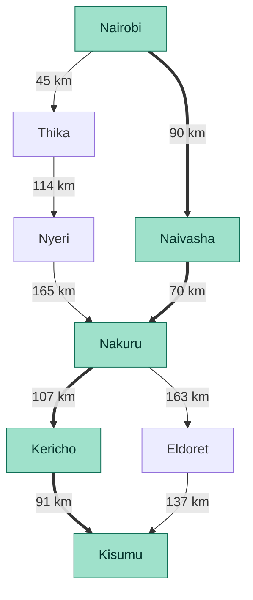
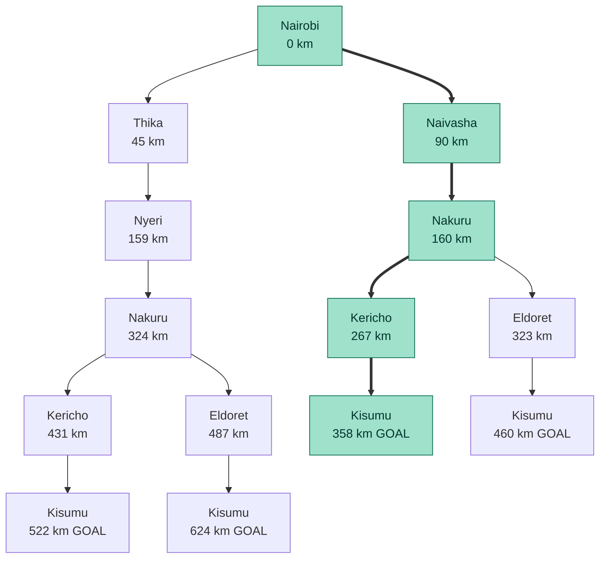

# Practical Exercise 3: Designing a Searching Agent

**179192 Mahir Nuzrat**

**188922 Itegi Ronald**

**145888 Irungu Gift**

**Question 1: Designing the Self-Driving Trailer Agent.**

**a. PEAS Framework**

The agent is a self-driving trailer (truck and trailer) that transports goods between towns along Kenya's highway network.

| Component | Description |
|---|---|
| **Performance measure** | Safe and on-time delivery of goods; Cargo delivered safely and on time; shortest distance and time; lowest fuel consumption; no collisions; adherence to traffic regulations and speed limit; cargo not damaged|
| **Environment** | Kenyan highways and roads, towns and junctions, other vehicles (matatus, buses, private cars, other trucks), pedestrians, animals, road conditions (potholes, roadworks), weather (rain, fog), traffic signs and signals |
| **Actuators** | Steering, accelerator, brakes, gear system, indicators, headlights, horn, trailer coupling and braking system |
| **Sensors** | GPS, cameras, radar, lidar, ultrasonic sensors, speedometer, fuel gauge, tyre pressure sensors, weather sensors |

**b. Properties of the Environment (the 5 definitions)**

| Property | Classification | Justification |
|---|---|---|
| **Observability** | Partially observable | The sensors only see the nearby road. The agent cannot see the whole network, traffic jams ahead, accidents or the intentions of other drivers. |
| **Determinism** | Stochastic | The next state is not fully determined by the agent's action. Traffic, breakdowns, weather and other drivers add uncertainty. |
| **Episodic vs Sequential** | Sequential | Every decision (which road to take, when to overtake) affects later decisions and the final outcome of the trip. |
| **Static vs Dynamic** | Dynamic | The environment keeps changing while the agent is deciding, because vehicles move, traffic changes and weather changes. |
| **Discrete vs Continuous** | Continuous (driving); discrete (route planning) | Speed, position, steering angle and time are continuous values. The map abstracted into towns and roads is a discrete set of states and actions. |

In addition, the environment is **multi-agent** (other vehicles and people act on their own) and **known** at the map level, since the highway network is available in advance.

**Question 2: Directed Graph and Search Tree**

**a. Abstraction**

The real road network has thousands of roads, junctions, villages and road details (lanes, bends, potholes). To make the search problem manageable, we apply **abstraction**: we remove irrelevant things and keep only what matters for efficient planning of the route.

- Each **major town or city** is a single **node** (state). Streets and estates inside the town are ignored.
- Each **major highway link** between two towns is a **directed edge** (action) carrying a **distance in km** as its cost.
- Minor roads, side junctions, road conditions, traffic and weather are ignored here.

| Region | Towns (nodes) |
|---|---|
| Nairobi | Nairobi |
| Central Highlands | Thika, Nyeri |
| Rift Valley | Naivasha, Nakuru, Kericho, Eldoret |
| Lake Victoria Basin | Kisumu |

**b. Problem Formulation**

- **Initial state:** At Nairobi
- **Actions:** Drive from the current town to a directly connected town
- **Transition model:** Result(At(X), Drive(X, Y)) = At(Y)
- **Goal test:** At Kisumu
- **Path cost:** Sum of road distances in km

**c. Directed Graph**

The trailer travels from Nairobi towards Kisumu (west), so the edges are directed that way. Distances are road distances from Google Maps.

| From | To | Distance (km) |
|---|---|---|
| Nairobi | Thika | 45 |
| Nairobi | Naivasha | 90 |
| Thika | Nyeri | 114 |
| Naivasha | Nakuru | 70 |
| Nyeri | Nakuru | 165 |
| Nakuru | Kericho | 107 |
| Nakuru | Eldoret | 163 |
| Kericho | Kisumu | 91 |
| Eldoret | Kisumu | 137 |

*Figure 1: Directed graph of the abstracted highway network. Thick arrows and green nodes show the optimal route.*

**d. Search Tree**

The root is the initial state (Nairobi). Each child is a town reachable from its parent by one action. Each Kisumu leaf is a goal state. The number under each town is the path cost from Nairobi.

*Figure 2: Search tree from Nairobi to Kisumu. The green branch is the optimal path.*

No town is repeated along any branch, so the tree has no loops. Abstraction keeps the tree small, because only 8 major towns are used instead of every road and junction.

**Question 3: Optimal Path from Nairobi to Kisumu**

**a. Distances Between Towns**

The distance between each pair of towns was obtained using the Google Maps search feature. For example, "Nairobi to Nakuru distance" returned about 156 to 161 km by road, which matches the 90 km + 65 km used above. All distances are road distances in km, as listed in section 2.3.

**b. All Possible Paths and Their Costs**

| No. | Route | Calculation | Total (km) |
|---|---|---|---|
| 1 | Nairobi → Naivasha → Nakuru → Kericho → Kisumu | 90 + 70 + 107 + 91 | **358** |
| 2 | Nairobi → Naivasha → Nakuru → Eldoret → Kisumu | 90 + 70 + 163 + 137 | 460 |
| 3 | Nairobi → Thika → Nyeri → Nakuru → Kericho → Kisumu | 45 + 114 + 165 + 107 + 91 | 522 |
| 4 | Nairobi → Thika → Nyeri → Nakuru → Eldoret → Kisumu | 45 + 114 + 165 + 163 + 137 | 624 |

**c. Uniform-Cost Search (confirming the result)**

Uniform-cost search always expands the node with the lowest path cost so far. It is optimal when the path cost is distance.

| Step | Expanded node (cost) | Frontier after expansion |
|---|---|---|
| 1 | Nairobi (0) | Thika (45), Naivasha (90) |
| 2 | Thika (45) | Naivasha (90), Nyeri (159) |
| 3 | Naivasha (90) | Nyeri (159), Nakuru (160) |
| 4 | Nyeri (159) | Nakuru (160) via Naivasha kept; Nakuru (324) via Nyeri discarded |
| 5 | Nakuru (160) | Kericho (267), Eldoret (323) |
| 6 | Kericho (267) | Eldoret (323), Kisumu (358) |
| 7 | Eldoret (323) | Kisumu (358) kept; Kisumu (460) via Eldoret discarded |
| 8 | Kisumu (358) | GOAL reached |

**d.**

The **optimal path** is:

**Nairobi → Naivasha → Nakuru → Kericho → Kisumu, with a total distance of about 358 km.**

It has the lowest total path cost of all four possible routes, and uniform-cost search, which is optimal for positive distance costs, returns the same path. The Central Highlands detour through Thika and Nyeri is much longer (510 km or more), so the trailer should use the Rift Valley highway through Naivasha and Nakuru.
